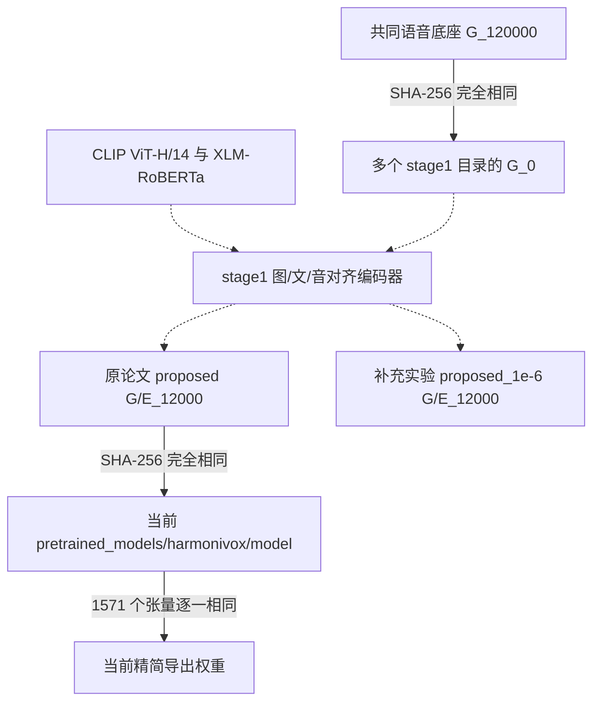

# Checkpoint 血缘与推理入口核查

核查日期：2026-11-25。原研究目录仅执行读取，本轮记录保存在工作区 `outputs/harmonivox-lineage/`。

## 当前可以确定的结论

结合 MM25 作者主页发布的论文 PDF Table 2/3，重算现存 SCP 的域内六项与域外三项分类指标后，九项数值全部匹配 `paper_used/proposed` 对应的结果家族。当前 `pretrained_models/harmonivox/model/` 的两份原始权重与该目录逐字节相同，默认 `paper-proposed` 保持不变，作为与 MM25 发表结果对应的发布候选。

较新的完整实验 `proposed_1e-6` 虽被最后的 WebUI 配置及名为 MM25 的分析脚本选中，但其结果不匹配发表表格。现已将它标为 `experimental-proposed-1e-6`，避免把补充实验误称为最终发表模型。上一轮依据最后配置推荐该实验的判断已被结果指纹纠正。详见 [MM25 最终模型溯源](MM25_FINAL_MODEL.md)。

原论文主模型目录（相对于研究仓库）：

```text
data/emotional/paper_used/proposed/models_dp_bn_gan_pt_5e-5_norm_330k_ft_5e-6_qformer_textual_iam_iac_stage1_wo_ia_add_ia_stage2_unift
```

后续补充实验完整主模型目录：

```text
data/emotional/ablations_loss/models_dp_bn_gan_pt_5e-5_norm_330k_ft_5e-6_qformer_textual_stage1_anneal_1e-6_200_stage2_unift
```

两套模型都是 `G_12000.pth` + `E_12000.pth`，内部 `iteration=31`；相同文件名、步数和 epoch 不代表相同实验。

## 身份证据：完整 SHA-256

| Profile | 文件 | 原始 checkpoint SHA-256 |
| --- | --- | --- |
| `paper-proposed` | `E_12000.pth` | `c7f72e10d669c47b3a494d3f9a335bac89b41ef2a9c07ec16f3fe9fcdc440a90` |
| `paper-proposed` | `G_12000.pth` | `574f5d4a764c3e72598b76eb267ee382d8d30da3bdfbc764943a1d176a960b15` |
| `experimental-proposed-1e-6` | `E_12000.pth` | `35e1ead71ae6d6dcaa1e85d3bb24069508422653ea6f479ec03e573529406961` |
| `experimental-proposed-1e-6` | `G_12000.pth` | `b2a629469f3904b1004e559a64f5ddc1ca038e0af67d4cca86995e638480379d` |

`paper-proposed` 还登记了上一轮精简导出文件的哈希；原始/导出格式均可使用。导出后的 835 个 G 张量和 736 个 E 张量已逐一验证与原始文件一致。`release_models.json` 是运行时身份清单，启动合成会验证配置及 G/E 的哈希，防止同一步数的不同实验被混用。

## 现存 checkpoint 家族

研究目录扫描到 70 份 `.pth`，分布在 15 个物理目录；其中原始 G/E 为 26 份，加上当前候选的 G/E 拷贝共对 28 份文件计算了完整哈希。`data/evaluation/paper_used` 和 `data/evaluation/ablations_loss` 分别是 `data/emotional/` 下对应目录的符号链接，不是新训练分支。

以下表格列出保留了 G/E 12000-step 配对的主要家族。哈希前缀用于阅读，运行时使用上面的完整值。

| 家族/目录标记 | G 哈希前缀 | E 哈希前缀 | 判定 |
| --- | --- | --- | --- |
| `1e-5_200_stage2_unift` | `308d65df9d8a` | `5937167a6bcc` | 完整 proposed 实验 |
| `1e-5_200_wo_c_loss_stage2_unift` | `05299e9ab62c` | `392a6fe266a1` | 按目录/配置标记为 `wo_c_loss` 消融 |
| `1e-5_200_wo_m_loss_stage2_unift` | `3479ab922080` | `fa5ffa487ede` | 按目录/配置标记为 `wo_m_loss` 消融 |
| `1e-6_200_stage2_unift` | `b2a629469f39` | `35e1ead71ae6` | 完整 proposed 实验 |
| `1e-6_200_wo_c_loss_stage2_unift` | `64fead938851` | `ea227222393b` | 按目录/配置标记为 `wo_c_loss` 消融 |
| `1e-6_200_wo_m_loss_stage2_unift` | `0aaa079eb098` | `f29a8f5e8204` | 按目录/配置标记为 `wo_m_loss` 消融 |
| `paper_used/proposed` | `574f5d4a764c` | `c7f72e10d669` | 原论文主模型；与当前发布候选完全相同 |
| `MEAD-only stage2` | `260318b4eeba` | `96d06b496169` | 单独的数据域实验，不是当前发布模型 |

## 能证明的训练关系与证据缺口

1. **共同语音底座的文件拷贝关系已经证明。** 以下五处文件的完整 SHA-256 都是
   `668807f46fc90e9b8b445aadf549745ad92b29b1a0a82e21fccdb4ab464c2ccd`：

   - `data/emotional/models_dp_bn_gan_pt_5e-5_norm_330k_ft_5e-6/G_120000.pth`
   - `data/mead-tts/models_dp_bn_gan_pt_5e-5_norm_330k_ft_5e-6/G_120000.pth`
   - MEAD `qformer_ft_stage1/G_0.pth`
   - MEAD `qformer_textual_stage1_anneal/G_0.pth`
   - emotional `stage1_anneal_1e-5_200/G_0.pth`

   `G_0` 在这些目录中是重新命名的已有底座，内部 `iteration=16`；不是随机初始化的第零步模型。
   目录名中的 `330k` 也不能代替实际保留文件的步数和训练记录。

2. **主线训练流程由代码确认。** `train_qformer_textual_multi.py` 冻结 G，使用图片、描述文本、
   音频风格特征训练 E，包含图文、音文和图音的 contrastive/matching 损失及 annealing。
   `train_qformer_textual_multi_unift.py` 之后使用 `net_e(img)` 作为 G 的全局条件，
   以生成目标联合微调 G/E。CLIP visual encoder 的冻结是编码器类里的单独设置。

3. **现存 stage1 的具体训练日志存在，但不能直接指定为所有 stage2 的父节点。**
   emotional `stage1_anneal_1e-5_200/train.log` 第 4 行加载 `G_0`，第 17983 行保存
   `E_88000`，内部 epoch 为 198。MEAD stage1 日志保留 `E_83000`；MEAD stage2
   第 4 行却加载了当时的 `E_0`（epoch 78），不能把后来的 `E_83000` 当成该次 stage2 的起点。

4. **原论文主模型和 补充实验完整模型都与共同底座有一致的参考编码器。** 逐张量比较：
   `ref_enc` 的 54 个张量与底座相同，其余 G 的 781 个张量不同。这支持沿用语音底座的解释，
   也符合联合微调时从图片取得条件、参考编码器不参与该路径的代码行为；这不等于完整的训练来源证明。
   发表模型 G 与补充实验 G 之间同样是 54 个张量相同、781 个张量不同。

5. **补充实验 1e-6 的现存日志是加载/评测日志，不是完整训练记录。** 完整 proposed 的
   `train.log` 第 2–3 行在 2025-06-16 加载 G/E 12000；后续又加载一次。
   `wo_c` 和 `wo_m` 有各自的加载日志。它们的配置中的 `model_dir`、`data/evaluation` 路径
   通过符号链接落到实际的 emotional 目录。不能把这些日志误当作从 stage1 到 stage2 的完整训练链。

6. **目录里的学习率标记不能直接当作优化器真实初始值。** 所有这些 stage2 文件顶层的
   `learning_rate` 都是 `1e-6`，但原论文 G/E 优化器的 `initial_lr` 是 `5e-6`，
   后来的补充实验中仍出现 `1e-5` / `5e-5`。这反映了恢复训练时保留的优化器字段；
   缺少启动日志时，不能据这些值反推出每一阶段的实际学习率计划。

7. **具体父 checkpoint 的缺失必须保留为未知。** 原论文主模型的完整训练日志和早期 E 父文件、
   补充实验的部分 stage1 文件已不在现存目录里。checkpoint 本身只保存 `model/optimizer/iteration/learning_rate`，
   没有 parent hash 或实验 ID。对现存 `E_88000` 与后来完整 stage2 E 的非 visual 参数比较，
   也不能建立逐文件的直接拷贝关系。目录名和模型结构不足以补全缺失边。

下面的实线表示已验证的文件相同关系；虚线表示代码支持的训练流程或候选血缘，具体父文件未证明。



另有一份旧 `paper_used/ablation_wo_ia/.../D_0.pth` 无法作为 PyTorch ZIP 读取。
它是未选入发行包的判别器，不影响这两套 G/E 的可读性与推理核查。

## 为什么历史默认入口会选出不同权重

| 位置 | 实际选择 | 含义 |
| --- | --- | --- |
| 研究 `config.yml` 的 `train_ms.model` | `1e-6_200_wo_c_loss_stage2_unift` | 训练/旧批量评测默认落在消融模型 |
| 研究 `config.yml` 的 `webui.model` | `1e-6_200_stage2_unift` | 较新完整 proposed 实验 |
| 研究 `webui_batch_quantitative.py` | 使用 `webui.model`，输出 `quant_ablation_proposed_1e-6` | 较新完整模型的外域评测路线 |
| `analysis_rebuttal_mm25.py` 第 40–41 行 | `quant_ablation_proposed_1e-6.scp` 及对应音频目录 | 补充实验完整模型的评测代码指向 |
| 当前本地 `pretrained_models/harmonivox/model` | 与 `paper_used/proposed` 文件相同 | 已拷贝的原论文发布候选 |

`infer_qformer_textual_multi.py` 是历史数据集评测脚本：加载数据列表、预提取 BERT、参考频谱，
创建评测输出目录；它的模型路径跟随 `train_ms.model`，也会复制配置文件，并在加载失败时继续走异常分支。
因此不把它作为本轮公开单样本推理入口。

## 已核查的最终推理链路

```text
inference.py                       ← 对外命令入口
  ├─ release_models.json           ← 校验配置及 G/E 哈希，显式选择模型身份
  ├─ configs/harmonivox.json        ← 固定的已验证推理配置
  └─ infer_web_qformer_textual_multi.py
       ├─ get_net_g                ← 显式步数，严格加载完整 G/E
       ├─ get_text                 ← 对应语言的音素、声调、BERT
       └─ infer
            ├─ Blip2Qformer(image) ← 只需图片，不需训练时的描述文本或参考音频
            └─ SynthesizerTrn.infer(g=image_features, y=None)
```

核查结果：

- 共享 backend 的 `get_text`、`infer`、`infer_multilang` 与原研究实现的 AST 相同。
- `models.py`、`attentions.py`、`commons.py`、`modules.py`、`transforms.py`、
  `meta_modules.py`、`mel_processing.py` 和 `text/symbols.py` 的 AST 与原研究实现相同。
- 当前原始 JSON 与研究 `data/evaluation/configs/config_norm_qformer_textual_stage2_test.json` 内容相同；
  发布配置从它删去语料、说话人清单和非推理部分，保留所需架构设置。
- 从原研究文件直接加载 WebUI backend 对照运行，英文 PCM 与发布 CLI 完全相同。
- 固定合成 RNG 后改变图片编码得到不同音频，证明输出实际经过图片条件路径；不依赖参考音频。
- 非当前语种的 BERT 输入按原训练 `data_utils.py` 第 185–196 行使用随机占位，保持训练/推理一致；未擅自改为零张量，随机数由 CLI 的 seed 控制。
- 当前模型 `use_sdp=false`。实测同时改动 `sdp_ratio`、`noise_scale_w`，音频逐值相同。
  两个无效控制项已从公开 CLI 移除，保留有效的 `noise_scale` 和 `length_scale`。
- 公开 CLI 默认步数固定为 12000；使用 profile 的完整哈希拒绝同名、同结构的消融或混合配对。
  其他实验须显式选择 `--model-profile custom`，不应作为已验证的官方模型发布。
- 原共享文件底部引用未定义变量的旧 `__main__` 演示块已移除，直接执行它会提示改用 `inference.py`。

原论文模型的最终 CLI 中英文回归、最终源码 ZIP 解压后的英文推理均通过；英文与原研究 backend 的 PCM 完全相同。修订完整主模型也已通过英文 CPU 推理。9 项自动检查通过，并用实际 `wo_c_loss` checkpoint 验证了同名消融权重会被拒绝。

CPU 对照覆盖上述短句；独立安装与 CUDA 中英文验证另见 [安装记录](CLEAN_INSTALL.md) 和
[CUDA 记录](CUDA_VALIDATION.md)。日文不在本次验证范围。

## 复查命令与产物

完整库存、可读性、加载/保存日志、目录别名和 G/E 文件哈希可重新生成：

```bash
python scripts/audit_checkpoints.py \
  --research-root /path/to/Image2Voice/Bert-VITS2-master \
  --candidate-dir ../pretrained_models/harmonivox/model \
  --hash-ge \
  --output ../outputs/harmonivox-lineage/audit_report.json
```

推理资源和当前候选身份检查：

```bash
python inference.py --language EN --check-only --verify-weights
```

本轮本地报告保存在 `../outputs/harmonivox-lineage/`：`checkpoint_hashes.json`、
`checkpoint_metadata.json`、`audit_report.json`、`tensor_comparisons.json`、
`inference_audit.json`，以及对应的音频和推理日志。机器路径和这些评测产物不打入公开源码包。
